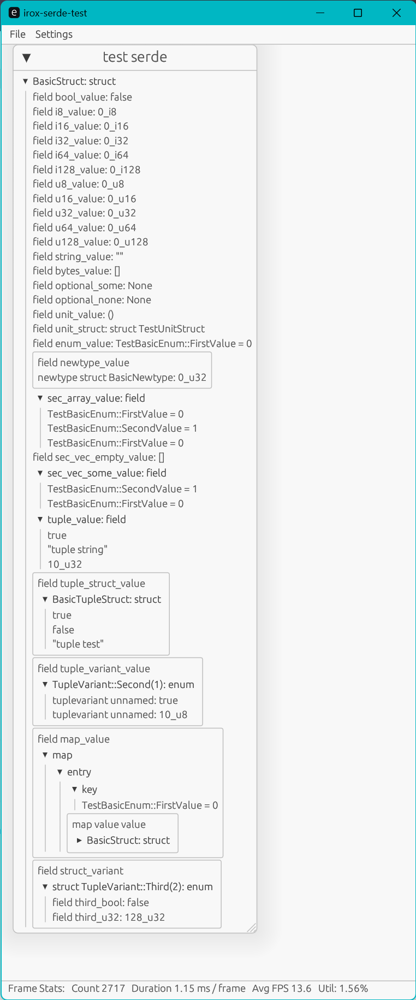
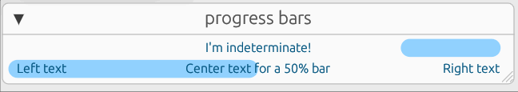
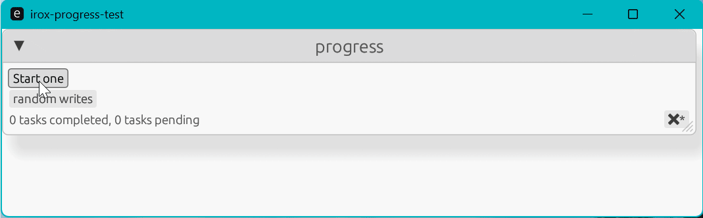

irox Extras for egui
=================================

`Stuff that should have been in egui, but isn't.`


Features
---------

### Widgets:

#### Field editors

`irox_egui_extras::widgets` includes typed field editors for nullable booleans,
string arrays, unique values, and single-select relations. Unique Values takes a
slice of existing strings and offers editable autocomplete or a restricted
dropdown. Value Relation takes caller-ordered key/label pairs and stores the key.
Each editor returns the validity and change status of the current field value.
The library works with native and WebAssembly egui applications.

Set `FieldDescriptor::help_description` to show help when hovering over the
field label or control. `RestrictedValueDropdown::new` and
`UniqueValuesEditor::restricted` borrow plain value slices.
Pass a slice of `RestrictedValue` options to `RestrictedValueDropdown::with_options`
or `UniqueValuesEditor::restricted_with_options` to supply per-option help.

The native form example shows all four editors.

```sh
cargo run -p irox-egui-extras --example editors --features eframe,wgpu
```

#### EGUI/Serde Serializer for Debugging Objects visually:



Use:

```rust
    let object = (); // your object that impls Serialize
let mut ser = EguiSerializer::new();
if let Ok(()) = obj.serialize( & mut ser) {
ser.show(ui);
}
```

In the above screenshot, `ui` is a `Window`

#### ProgressBar

Drop-in replacement of egui's ProgressBar widget with some tweaks:

* Removes the animated spinner for performance
* Adds the ability to mark the bar as 'indeterminate' and show a bouncing bar back and forth
* Adds the ability to right align, center, and left align text in the bar. These are not mutually exclusive, and you can
  have text in all three positions simultaneously.




### Frames, Apps, & Infrastructure

#### ToolFrame & ToolApp

Boilerplate bootstraps to make writing tools in egui easier. See the screenshot above for an example of the ToolFrame.

You must impl `ToolApp` to use `ToolFrame`

#### StylePersistingApp

Wraps your App impl to automatically persist your App state to disk. Requires features `serde`

#### CompositeApp

Allows you to compose multiple Apps together. The `update` method will be called sequentially, in the order the apps
are provided.

### OpenStreetMap slippy-map example

```sh
cargo run -p irox-egui-extras --example slippy_map --features eframe,glow
```

The native example registers an asynchronous HTTP/PNG image loader using the
existing workspace `ehttp` and `irox-imagery` dependencies. It uses XYZ row
numbering for OpenStreetMap, displays attribution, and sends an application
User-Agent. Drag to pan and scroll or pinch to zoom.

Tiles are cached on disk for seven days. Set `IROX_OSM_CACHE_DIR` to choose a
persistent cache directory; otherwise the example uses `irox-osm-tiles` in the
system temporary directory. Keep that directory between runs to avoid repeat
downloads. Errors appear above the map. Internet access and a graphical desktop
are required. Follow the [OpenStreetMap tile usage policy](https://operations.osmfoundation.org/policies/tiles/).

Set the map's tile width with `SlippyMap::new(url).tile_size(512)` or
`map.set_tile_size(512)`. The default is 256 PNG pixels. Tile dimensions are converted to egui points using
the current pixels-per-point scale (including display DPI and egui UI zoom).
Panning, zoom anchoring, visible tile selection, and retained tiles use this size.
To configure the example for a 512-pixel tile size:

```sh
IROX_MAP_TILE_SIZE=512 cargo run -p irox-egui-extras --example slippy_map --features eframe,glow
```

OpenStreetMap's standard endpoint returns 256-pixel PNGs, so leave its tile size
at the default 256 for native pixel sizing. The 512 setting demonstrates the
configuration for a server returning 512-pixel PNGs; it does not change the
server's URL or image resolution. At two screen pixels per egui point, a
512-pixel tile occupies 256 points at an integer map zoom level.

See [slippy-map integration and troubleshooting](doc/slippy_map.md) for coordinate
contracts, loader/cache ownership, transition behavior, limitations, and tests.
